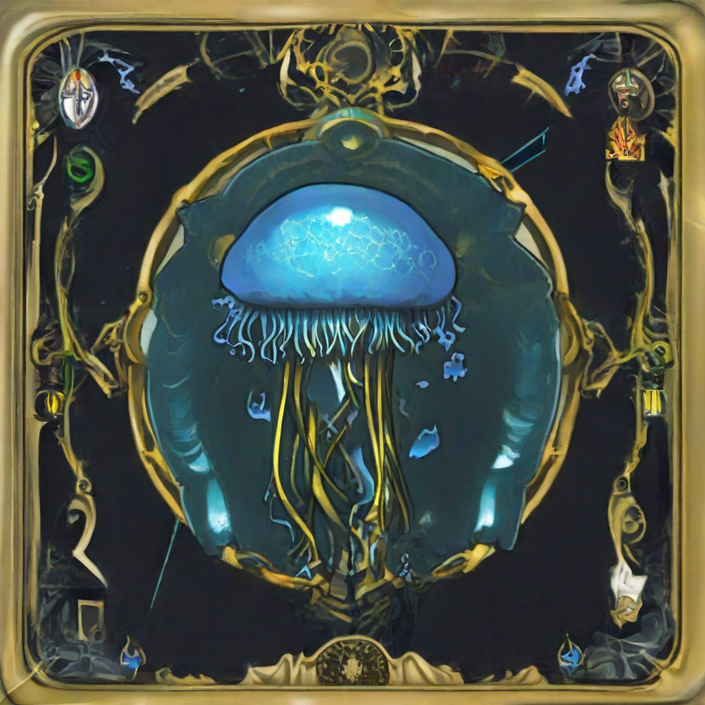

# 深淵幻藏 Abyssal Archive

[English](./README.md) · **繁體中文**

> **暗黑奇幻卡牌召喚** — 每日免費抽卡、3D 全息卡牌，以及瀏覽器本機典藏

<p align="center">
  
</p>

<p align="center">
  <a href="https://reikama414.github.io/abyssal-archive/">線上示範</a>
  ·
  <a href="https://github.com/ReiKama414/abyssal-archive">Star</a>
  ·
  <a href="https://reikama414.vercel.app/">個人網站</a>
  ·
  <a href="#快速開始">快速開始</a>
  ·
  <a href="#license--權限">授權</a>
</p>

---

## 為什麼做

一個可在本機瀏覽器完整遊玩的暗黑奇幻卡牌體驗：永久系列、節慶卡包、保底計數與 3D 展廳，收藏與進度皆保存在裝置本機

---

## 亮點

- **414 張卡牌** — 四大永久系列各 72 張 · 九大節慶各 14 張
- **13 款卡包** — 常駐池與節慶限定時程
- **每日免費抽** — 台北時間午夜重置 · SR / UR / EX 保底
- **3D 卡牌** — 變體箔面、傾角、翻面與全螢幕檢視
- **開包儀式** — 撕箔 → 揭曉 → 結果一覽
- **3D 展廳** — 最多陳列五張已擁有卡牌
- **本機典藏** — 圖鑑、保底與抽卡紀錄存於裝置

---

## 技術棧

| 層級 | 選用 |
| --- | --- |
| 框架 | Next.js 16 · React 19 · TypeScript |
| 樣式 | Tailwind CSS 4 |
| 3D／動效 | Three.js · GSAP · canvas-confetti |
| 狀態 | Zustand |
| 圖示 | Lucide |
| 字體 | Cinzel · LXGW WenKai TC · Chiron Hei HK · Oxanium · IBM Plex Mono |

---

## 快速開始

需要 Node.js 20+ 與 npm

```bash
npm install
npm run dev
```

開啟 [http://localhost:3000](http://localhost:3000)

```bash
npm run build
npm start
npm run lint
```

---

## 遊玩流程

1. **首頁** — 品牌主視覺，進入召喚或圖鑑
2. **卡包召喚** — 選擇系列 · 單抽／五連／十連（底部固定列）
3. **開包** — 撕開箔封 · 可隨時跳過 · 逐張揭曉
4. **結果** — 3D 檢視 · 返回卡包或前往展廳
5. **圖鑑** — 篩選、最愛、完成度與抽卡歷史
6. **3D 展廳** — 編輯最多五張已獲得卡牌上架

> **提醒：** 每日免費抽數於 **台北時間 00:00** 重置

---

## 專案結構

```text
abyssal-archive/
├── public/                 # 靜態資源 · 卡面 · 品牌標記
├── scripts/                # 資料／QA／輔助腳本
├── src/
│   ├── app/                # Next.js 殼層 · layout · page
│   ├── components/         # 首頁 · 召喚 · 卡牌 · 收藏 · 模態
│   ├── data/               # 卡牌與卡包定義
│   ├── lib/                # 抽卡 · 儲存 · 音訊 · store
│   └── types/              # 共用 TypeScript 型別
├── LICENSE
├── README.md
└── README.zh-TW.md
```

---

## 第三方說明

執行期與工具鏈依賴各自保留原授權（Next.js、React、Three.js、GSAP、Zustand、Lucide、canvas-confetti，以及經 `next/font` 載入的字型）。那些條款只適用於對應套件，不及於本專案原創程式、品牌、文案與圖像

本專案原創資產（原始碼、介面設計、卡池文案、品牌標記，以及 `public/` 內插畫與視覺）適用下方專案授權，**不是** MIT／Apache 開源

---

## 連結

| | |
| --- | --- |
| 線上示範 | [reikama414.github.io/abyssal-archive](https://reikama414.github.io/abyssal-archive/) |
| GitHub | [ReiKama414/abyssal-archive](https://github.com/ReiKama414/abyssal-archive) |
| 個人網站 | [reikama414.vercel.app](https://reikama414.vercel.app/) |
| 作者 | [ReiKama414](https://github.com/ReiKama414)（Myers） |
| 授權全文 | [LICENSE](./LICENSE) |

---

## License / 權限

Copyright (c) ReiKama414. All rights reserved.

本專案僅供個人瀏覽與學習。未經著作權人書面同意，
不得使用、複製、修改、散布或併入其他專案（含非商業用途）

- [GitHub](https://github.com/ReiKama414/abyssal-archive)
- [個人網站](https://reikama414.vercel.app/)
- [授權全文](./LICENSE)

---

<sub>深淵幻藏 Abyssal Archive · ReiKama414 · All rights reserved</sub>
